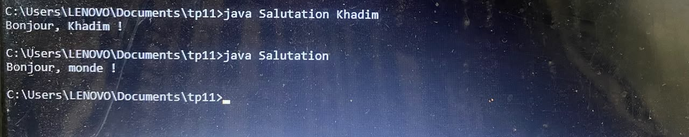
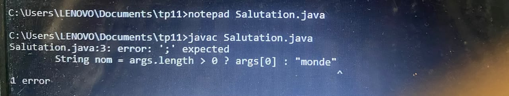
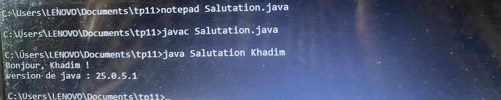

# TP1.1 - Installation du JDK et premier programme

**Étudiant :** Khadim Ndour
**Établissement :** ESP, filière GLSI
**Cours :** Séquence 1 - L'environnement de travail et remise à niveau (Dr Guy MBATCHOU)

## 1. Versions du compilateur et de l'interpréteur


## 2. Fichier source

Le fichier `Salutation.java` est dans ce dépôt.

```java
public class Salutation {
    public static void main(String[] args) {
        String nom = args.length > 0 ? args[0] : "monde";
        System.out.println("Bonjour, " + nom + " !");
        System.out.println("Version de Java : " + System.getProperty("java.version"));
    }
}
```

## 3. Exécution

Avec un argument, puis sans argument :



Après ajout de l'affichage de la version de Java :



## 4. Erreur de compilation volontaire

J'ai retiré le point-virgule à la fin de la ligne `String nom = ...`. Message affiché par `javac` : `error: ';' expected`.



